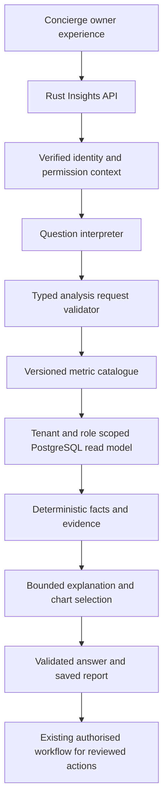

# Concierge Business Insights: a Rust offering informed by Lumen

Assessment: 20 November 2026. User requirement: implement the new offering in Rust. Lumen replaces the originally supplied CodeDen repository, which is out of scope.

## Recommendation

Build **Concierge Business Insights** as a Rust-native capability inside Concierge: useful operational answers, evidence, and a reviewable next step. Use Lumen as a source of product and architecture ideas. Do not embed its Python runtime, deploy a Python sidecar, or attempt a line-by-line port.

The first offering should answer: **What needs my attention? Which enquiries and quotes have stalled? What changed, and what records support that answer?** Start with information Concierge already holds. Accounting, stock, staffing and forecasting come later, when authoritative data exists.

This is a source-backed product and engineering assessment, not a tested implementation. Lumen was statically inspected at commit `ce9b198b08369dbb0094b9f9486ed54d8fce7473`; Concierge at `08fee3e0a41e7c6ce97f19775a411437c2501644`. No packages were installed, customer records exported, prototype benchmarked, application code changed or deployment performed. Main-branch capabilities must be checked against any selected stable release.

## 1. What Lumen does, and what is valuable to us

[Lumen](https://github.com/holoviz/lumen) is a Python framework for exploring data through natural-language questions, SQL, visualisation, reports and extensible agents. Its value is the progression from a question to an executable analysis and a useful presentation. It is not a complete small-business operating system, accounting ledger or tenant-authorisation layer.

| Lumen capability | Concierge adaptation in Rust | Priority |
|---|---|---|
| Natural-language analysis | Translate a question into a validated, typed metric request | First release |
| Data/source discovery | Show only the customer’s approved data and its coverage | First release |
| Charts and tables | Render validated results with a few fixed chart templates | First release |
| Reports | Save reproducible reports with definitions, period and freshness | First release |
| Agent planning | A short, bounded analysis state machine | After simple flows work |
| Document context | Retrieve authorised metric definitions and business terminology | Later |
| Open-ended SQL | Consider only if curated metrics cannot meet proven demand | Deferred |
| Generated Python/custom code | Exclude from the offering | Excluded |
| Arbitrary source uploads and dashboard editing | Managed operator tooling if demand warrants it | Deferred |

Lumen already supports headless coordination; a Python UI is not its only integration path. However, headless Lumen still runs Python and therefore does not meet the Rust requirement. Its REST publisher is not a ready-made tenant-safe conversational API. We should reproduce the small set of behaviours customers need, rather than port the framework.

Source: [headless coordinator tests](https://github.com/holoviz/lumen/blob/ce9b198b08369dbb0094b9f9486ed54d8fce7473/lumen/tests/ai/test_coordinator.py), [REST publisher](https://github.com/holoviz/lumen/blob/ce9b198b08369dbb0094b9f9486ed54d8fce7473/lumen/rest.py).

## 2. Why small businesses would use it

The product proposition is practical help with follow-up and decisions, without another system to configure. MBIE’s current digital-capability research identifies affordability, demonstrated return, skills and choosing tools as adoption barriers. This supports managed onboarding, predictable charges and ready-made answers. It does not establish willingness to pay for this particular feature. [MBIE research](https://www.mbie.govt.nz/business-and-employment/business/support-for-business/research-and-reports-for-small-business/digital-capability-of-new-zealand-businesses).

| Constraint | Product response |
|---|---|
| Owner has little time | A short attention list and three suggested questions on arrival |
| Tools and information are fragmented | Start with Concierge data; add a connector only for a specific unanswered question |
| Unclear return on spend | Show records requiring attention and measure completed follow-ups |
| Limited budget | Included basic summary; capped optional analysis; visible usage and no surprise overages |
| Inconsistent or sparse records | Display coverage, missing links and denominators; explain what cannot be concluded |
| Low confidence in AI | Source links, fixed definitions, reproducible numbers and a correction path |
| Sensitive customer or staff information | Tenant and field permissions, minimal model exposure, limited retention |
| Little capacity for setup | Assisted onboarding and predefined metrics; no schema editor required |

Initial fit is strongest for trades and service businesses already using Concierge for enquiries and quotes. Appointment businesses become stronger candidates after authoritative booking outcomes are connected. Retail and hospitality generally need POS and inventory data before this can describe the business meaningfully. Regulated and highly sensitive use cases should not be the first unrestricted pilot. These segment choices are hypotheses to test.

For low-volume firms, a useful count and follow-up list can still help; forecasts and finely sliced conversion rates can mislead. Do not impose a universal sample threshold: show denominators and validate each comparison’s suitability.

## 3. What Concierge already provides

The inspected canonical source uses FastAPI/PostgreSQL for core operations and has a Rust social service. The new capability can be entirely Rust without rewriting the existing platform. Existing authentication remains the authority until deliberately migrated; this proposal does not silently replace it.

Relevant source files include `api/app/owner_auth.py`, `api/app/revenue.py`, `api/app/quote_payments.py`, `api/app/products.py`, `api/app/schema.sql` and `concierge-stack/social-service/Cargo.toml`.

Verified building blocks:

- Tenant users and sessions, with viewer/editor/owner roles.
- Leads and enquiry channels, quotations, invoices and appointment-related records.
- An authenticated owner revenue endpoint using deterministic reporting.
- Payment status where owner confirmation is distinct from a customer saying payment was made.
- Product costs protected as owner-only information.
- Rust experience in the repository: Tokio, Axum, Serde and Reqwest already appear in the social service.

Important limits:

- Existing quote reporting groups records by creation date. That is not the same as payments received during the period or quotes accepted during the period.
- Owner-confirmed paid status is not bank reconciliation.
- A product cost field does not establish complete job labour/material costs or reliable profitability.
- Calendar connectivity does not establish attendance, no-shows or available working capacity.
- Enquiry channel counts do not establish causal marketing return.
- The inspected accounting integration documents are designs, not proof of an implemented Xero connector.
- Existing API tenant predicates must not be bypassed by giving an analysis engine an unrestricted database connection. No applicable RLS policy was found in the inspected API schema search; this is not an audit of all deployment permissions.

We must define these meanings before presenting more confident answers than the underlying records support.

## 4. Rust architecture

### A small module interface

Use an internal Insights module with operations equivalent to `answer`, `get_report` and `save_report`. Its inputs include a server-verified access context, a question or metric request, a reporting period and an idempotency key. Its output is a typed answer envelope. Hide database selection, model routing, retries and evidence construction behind that interface.

Keep deployment simple: one Rust service with clear internal modules and an optional background worker, rather than a collection of new microservices. Isolate its resource budget from the critical phone/email response path. A PostgreSQL-backed job queue may be sufficient initially; a new message broker is not a prerequisite.

### Query execution

The model selects from an enum of approved analyses and validates parameters. Rust compiles that request to reviewed, parameterised SQL. The model does not write or execute SQL in the first release.

An illustrative request is `QuoteFollowups { period, minimum_age, status_filter }`. The server determines tenant identity and permissible fields; neither the prompt nor a browser-supplied tenant identifier grants access. Validate dates, ranges and list sizes. Bind values as query parameters and map dimensions through an allowlist.

The request need not use a model at all for a suggested question. Preserve this path as a cheaper, faster baseline and fallback. Finance totals and percentages remain deterministic; the model explains facts it is authorised to receive.

### Candidate Rust components

Reuse the repository’s conventions where sensible: Tokio for asynchronous work, Axum for HTTP, Serde for typed requests, Reqwest for provider calls and tracing for observability. Evaluate SQLx for PostgreSQL access. Pin tested versions; do not upgrade the existing social service solely to match a new service.

A direct provider adapter behind a small trait is sufficient initially. Evaluate Rig only if its provider/tool abstractions materially reduce code; an agent framework is not mandatory. Current docs establish Rust support, not compatibility with our exact requirements. [Axum](https://docs.rs/axum/latest/axum/), [SQLx PostgreSQL](https://docs.rs/sqlx/latest/sqlx/postgres/), [Rig](https://docs.rs/rig-core/latest/rig_core/).

Use integer minor units or suitable decimal arithmetic for money, explicit currencies, and timezone-aware periods. PostgreSQL can handle initial aggregation; introducing Polars or DuckDB is unnecessary until measured workloads justify it. Rust reduces some runtime classes of failure; it does not prevent authorisation mistakes, incorrect SQL or hallucinations.

### What “all in Rust” means here

All new backend logic, connectors, orchestration, calculations, scheduling, exports and policy enforcement should be Rust. No Lumen/Python runtime dependency is proposed. For a literal Rust-authored interface, use server-rendered pages with progressive forms first; if richer interaction is needed, assess a Rust/WASM approach separately. Browsers still consume HTML/CSS and browser runtime facilities. Existing Concierge frontend and API migration is outside this additive offering’s scope.

PostgreSQL and a chosen model provider remain infrastructure dependencies. A locally hosted model can be evaluated separately, but locality, model quality, hardware cost and provider terms must be assessed rather than inferred from the implementation language.

## 5. Trustworthy answer contract

Every answer should include:

1. A short answer and an attention list where appropriate.
2. Deterministic facts with units and denominators.
3. Reporting period, timezone and comparison period.
4. Source system, last successful sync and coverage limitations.
5. Metric-definition version and authorised links to supporting records.
6. A chart selected from constrained templates, when useful.
7. Clear uncertainty or missing-data statements.
8. A suggested next action that opens an existing review workflow.

For example: “Five quotes created last week remain awaiting a response, with a combined quoted value of NZ$8,400. This is quoted value, not cash received. Open the five records to review follow-up.” This is an illustrative format, not actual customer data.

A saved report must persist its definition and source/freshness context. Decide explicitly whether reopening shows a historical snapshot or recalculates current results; label the behaviour. Recheck authorisation on viewing, export and sharing. Provide accessible tables alongside charts and offer CSV first. Add branded documents only after validating Rust export tooling and customer demand.

## 6. Metric definitions before AI

Create a versioned catalogue covering enquiry counts, recorded channel, quote counts/status/value, follow-up age and confirmed payment status. Each definition needs owner, source, date basis, exclusions and test fixtures.

Resolve: created versus accepted versus paid dates; rolling windows versus calendar weeks; NZ timezone and daylight saving; GST-inclusive versus exclusive amounts; currency separation; partial payments; credit notes/refunds; duplicate joins; deleted/merged leads; status history; null versus zero; historical changes; and incomplete syncs.

If the prior period is zero, report a new baseline rather than inventing a meaningful percentage growth rate. Do not combine currencies using an arbitrary selected currency. Do not call a quote amount recognised revenue. Fields needed for an answer but absent from the source must produce a limitation, not an inferred event.

## 7. Security and privacy lessons from Lumen

Lumen’s generated-Python executor explicitly says in-process execution is unsuitable for adversarial input. Its SQL layer already has syntactic read-only checks and exploration limits; these do not establish tenant isolation or forbid every risky database function. Our Rust implementation should remove the need for arbitrary generated execution in its initial design. Sources: [executor warning](https://github.com/holoviz/lumen/blob/ce9b198b08369dbb0094b9f9486ed54d8fce7473/lumen/ai/code_executor.py), [SQL safeguards](https://github.com/holoviz/lumen/blob/ce9b198b08369dbb0094b9f9486ed54d8fce7473/lumen/data/sql.py).

Lumen also has data-sharing controls. Its default sample mode may send data values; schema mode reduces that exposure, while none still includes some metadata. PII masking is heuristic and defaults off. These are useful design lessons, not settings we will inherit in Rust. Source: [sharing implementation](https://github.com/holoviz/lumen/blob/ce9b198b08369dbb0094b9f9486ed54d8fce7473/lumen/data/sharing.py).

Required controls:

- Derive identity from trusted server authentication; preserve owner-only fields and existing role semantics.
- Use least-privilege database credentials and enforce scope independently of model instructions. Consider tested RLS as defence in depth, with pool/session reset and bypass-role behaviour explicitly verified.
- Include tenant, role, definition version and data version in cache ownership. Scope reports, logs, retrieval indexes and exports too.
- Send the minimum necessary aggregates to the model. Exclude contact details by default. Free-text questions can contain personal information and require their own treatment.
- Treat source text as untrusted data. It cannot grant permissions, select tools or change system policy.
- Enforce time, row, memory, concurrency, token and spend limits outside the model. Restrict network egress and validate rendered output.
- Avoid logging raw customer data or prompts by default. Define retention, deletion, backup expiry and incident response.
- Never let analysis independently send messages, change bookings, issue refunds or publish posts. Hand off drafts to the existing authorised workflow.

Schema-only model exposure cannot support a narrative about numeric results the model has never seen. Choose deterministic templates for those results, or explicitly authorise minimal aggregates. Test actual outbound requests rather than assuming a configuration label proves privacy.

NZ privacy duties continue to apply. Overseas processing requires assessment of actual purposes and contractual arrangements; offshore processing is not automatically prohibited or automatically compliant. Sources: [OPC AI guidance](https://www.privacy.org.nz/resources-and-learning/a-z-topics/ai/generative-artificial-intelligence/), [OPC overseas processing decision tree](https://www.privacy.org.nz/responsibilities/disclosing-personal-information-outside-new-zealand/decision-tree-page/), [Business.govt.nz safe AI guidance](https://www.business.govt.nz/operations/getting-started-with-ai/safe-and-smart-ai-use).

## 8. Product and commercial packaging

**Core:** a small operational summary and attention list using native records. This gives every customer visible value and supplies a comparison baseline.

**Business Insights add-on:** capped natural-language questions, saved comparisons, weekly in-app briefings and assisted setup. Make included sources, usage limits, support and freshness visible before purchase.

**Connected finance:** separately validated read-only accounting questions, such as overdue invoices and actual receipts. Do not market cash-flow forecasting or profitability until the necessary history, reconciliation and cost data exist.

**Managed/multi-location:** custom definitions, delegated adviser access and explicitly authorised consolidation. Charge for setup and support complexity; tenant membership does not itself grant group-wide reporting.

An illustrative economics exercise, not a validated price: at NZ$79/month excluding GST, NZ$4 model cost, NZ$3 compute and 10 support minutes at an assumed NZ$60/hour produce NZ$17 monthly variable cost and approximately 78% contribution margin before overhead and acquisition costs. At 40 support minutes the cost becomes NZ$47 and margin approximately 41%. This shows why support and onboarding must be measured. It does not predict actual usage or profitability. Add connector allocation, monitoring, payment fees, refunds and onboarding amortisation to a real model.

Do not offer unlimited analysis until measured. If an allowance is exhausted, retain the deterministic summary and explain the limit. A local model may reduce provider charges but introduces hardware, operations and evaluation costs.

## 9. Connector strategy and broader opportunities

Prioritise by unanswered customer decision, not number of integrations:

1. Native Concierge operational records.
2. Accounting for verified invoice/payment questions.
3. Booking/job systems for attendance, capacity and completed-work questions.
4. POS/inventory and advertising spend only for customer segments that need them.

A Rust connector needs tenant-bound OAuth state, encrypted tokens, rotation, least scopes, sync checkpoints, idempotent upserts, backoff, reconciliation and visible sync status. Historical imports and deletion/disconnection need explicit design. Prefer established SDKs only after maintenance and scope checks; direct documented HTTP APIs can be sufficient.

Vendor economics are a real constraint. Xero introduced connection/usage tiers effective March 2026; older integration cost assumptions should not be reused. Before building, verify the current commercial tier, API scopes, AI-use restrictions and customer permission. Do not train models on API data on an assumption that inference access grants training rights. [Xero pricing/policy FAQ](https://developer.xero.com/faq/pricing-and-policy-updates).

Further opportunities include recurring-question summaries, seasonal operational comparisons, quote follow-up drafts and adviser-ready evidence packs. Text classification needs its own labelled evaluation and privacy policy. Employee scoring, credit decisions, cross-customer benchmarking and autonomous financial actions carry additional data/permission requirements and should not be bundled into the initial promise.

## 10. Build sequence and decision gates

**Stage 1 — definitions and demand.** Choose three questions with existing customers. Inspect how each is answered today. Establish source fields, permissions, expected answers and missing events. Compare against the existing deterministic report.

**Stage 2 — Rust vertical slice.** Implement one authenticated analysis end to end, with fixtures, evidence links, limits and a fixed presentation. Add a model interpreter only after the deterministic path works. Verify the identity contract with the existing API rather than creating a second identity system.

**Stage 3 — bounded pilot.** Add the remaining approved metrics, saved reports, usage accounting and a scheduled in-app briefing. Use consenting customers with different data readiness. Weekly review measures meaningful decisions, completed follow-ups, incorrect answers, support minutes and total per-tenant cost.

**Stage 4 — expand from evidence.** Add the highest-value connector or bounded exploratory feature only after the pilot proves native questions useful. General SQL and a full dashboard builder are independent decisions, not inevitable roadmap commitments.

Estimate delivery after Stage 1 establishes data gaps and identity integration. A full framework rewrite would increase scope substantially; a narrow Rust capability avoids that unnecessary dependency. No calendar date or engineer-week estimate is justified from static inspection alone.

### Release gates

- Cross-tenant and cross-role fixtures, including owner-only cost fields, cached answers, reports and exports.
- Revoked sessions and membership changes enforced on subsequent reads and background jobs.
- Exact reconciliation of curated results, including timezone, zero baseline, missing values, currency and payment edge cases.
- Prompt injection cannot grant access or execute code/actions.
- Captured outbound model requests meet the agreed minimum-data policy.
- Rate limits, timeouts, cancellation, retry idempotency and spend caps work under load.
- Stale/failed syncs and unavailable models produce a useful deterministic fallback.
- Owners understand definitions and can challenge an answer; repeated useful actions justify support cost and proposed price.

Accuracy, privacy and performance targets must be agreed for the pilot. High chat volume is not proof of business benefit. No synthetic or static review substitutes for an isolation test in the deployed environment.

## 11. Licence, ownership and what remains unknown

Lumen’s BSD-3-Clause licence permits commercial adaptation subject to its notice and other conditions. Retain required notices for any copied code or material; do not imply upstream endorsement. A fresh Rust implementation avoids Python runtime coupling, but dependency licences and model/vendor terms still need review. [Lumen licence](https://github.com/holoviz/lumen/blob/ce9b198b08369dbb0094b9f9486ed54d8fce7473/LICENSE).

Unknowns that affect implementation are actual customer demand and willingness to pay, production schema completeness and data quality, definitive current access boundaries, selected model/provider terms, customer-specific accounting needs, latency under realistic load and operating/support cost. None requires delaying a clearly scoped feasibility slice; each needs evidence before expanding the commercial promise.

The recommended outcome is a focused Rust module that owns reliable business answers and can outlive any particular model or agent library. Concierge retains identity, source-of-truth records and authorised actions. Lumen supplies useful ideas, not a required production dependency.
